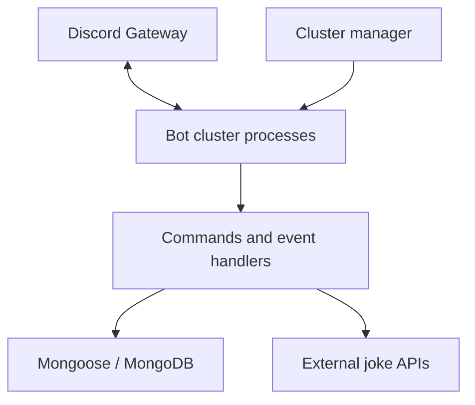

# DeezNutsBot

An event-driven Discord bot built with JavaScript, discord.js, MongoDB, and process-based hybrid sharding. Originally developed as **DeezNutsBot**, it responds to keyword triggers and slash commands while recording user and server activity. The original humor remains in `utils/jokes.js`.

This repository presents the application and its infrastructure as a technical portfolio project. It demonstrates command routing, database modeling, configuration management, and multi-process bot hosting. No scale or production reliability claims are implied.

> This is a standalone portfolio snapshot. See [validation](docs/VALIDATION.md) for the checks performed and the remaining runtime testing.

## Functionality

- Keyword matching, automated replies, and emoji reactions to guild messages.
- Ten slash commands: `/invite`, `/user`, `/leaderboard`, `/list`, `/support`, `/ping`, `/chucknorris`, `/dadjoke`, `/stats`, and `/vote`.
- User profiles and trigger counters, server metadata, and an upvote leaderboard stored through Mongoose models.
- External joke APIs: icanhazdadjoke and a RapidAPI Chuck Norris endpoint. The latter needs a separate key.
- Invite, support, and voting links configured per installation.

The current code links to voting pages and reads stored upvote counts. It does **not** implement a voting webhook or an active top.gg statistics publisher.

## Stack and architecture

| Component | Implementation |
| --- | --- |
| Runtime | Node.js; CommonJS JavaScript |
| Discord integration | discord.js 14 |
| Persistence | MongoDB with Mongoose 8 |
| Process orchestration | discord-hybrid-sharding 2 |
| Configuration | Environment variables and dotenv |
| HTTP requests | node-fetch 2 |
| Container packaging | Dockerfile and Compose added during release preparation |
| Verification | Node built-in test runner, syntax checks, supplemental secret scanner |



`index.js` launches the cluster manager. The manager requests the recommended shard count through the sharding library and groups shards into processes, with two shards per cluster. `bot.js` creates a Discord client, attaches its cluster client, initializes the database connection when enabled, and loads commands and events from their directories. This is single-host process clustering; it does not implement multi-host orchestration or database high availability.

### Database integration

`schemas/userSchema.js` defines unique user IDs, usernames, trigger and upvote counters, tags, active guild IDs, and timestamps. `schemas/serverSchema.js` stores guild IDs, names, owner IDs, membership counts, verification/partnership flags, join information, trigger counters, and membership status. Events and `utils/dbUtil.js` perform reads and updates.

Use a new development database with a least-privilege account for testing. `CONNECT_MONGODB=false` disables the database helpers and makes database-dependent commands return an unavailable message. Message text is inspected in memory for triggers; the defined schemas do not store full message content. User and guild identifiers are personal data: operators need an appropriate retention and deletion policy before offering this bot to others.

## Installation

Use Node.js 24 (the container and CI target); the declared minimum is 22.12.0. Dependency major versions are retained; compatible security updates were applied after an online advisory audit.

```bash
npm ci --ignore-scripts
cp .env.example .env
# Edit .env locally with new, rotated credentials.
npm run check
npm test
npm run register:check
```

The registration check builds command payloads without submitting them. **The following operations connect to external services and require your own authorization and test credentials:**

```bash
npm run register  # Replaces global slash commands for the configured application.
npm start        # Connects to Discord and, when enabled, MongoDB.
```

Create a Discord application and bot, enable the Message Content privileged intent, and invite the bot with the `bot` and `applications.commands` scopes. Configure only the channel permissions it needs: view channels, send messages, embed links, add reactions, and read message history. Larger installations may require Discord approval for privileged intents. Use an isolated test guild and application before production.

### Environment variables

| Variable | Purpose | Required |
| --- | --- | --- |
| `DISCORD_TOKEN` | Newly rotated Discord bot token | Startup and real registration |
| `DISCORD_CLIENT_ID` | Discord application ID | Startup and real registration |
| `MONGODB_URI` | MongoDB URI; use a new test database first | When database enabled |
| `CONNECT_MONGODB` | Strict `true` or `false`; defaults to `true` | No |
| `DEV` | Extra diagnostic logging; defaults to `false` | No |
| `RAPIDAPI_KEY` | RapidAPI key for `/chucknorris` | Only that command |
| `SUPPORT_URL` | Support link | Configure before use; example.com default |
| `UPVOTE_URL` | Voting link | Configure before use; example.com default |
| `INVITE_URL` | Optional custom invite link | Otherwise generated from application ID |

Old names (`TOKEN`, `MONGOPATH`, `CLIENTID`, `MONGODB_URL`, and `CLIENT_ID`) are not read by the sanitized application. Copy only newly issued values into the canonical variables. `.env.example` contains placeholders and a loopback database example. No real `.env` is included.

## Docker deployment

The original checkout had no Dockerfile or Compose file. This release preparation adds an unprivileged Node.js container, a read-only filesystem, dropped Linux capabilities, and bounded JSON logs. It does not publish any host ports: Discord and MongoDB connections are outbound. MongoDB is separately managed; `127.0.0.1` in the container points to the container, so replace the example URI with an authorized, reachable test database address.

Configuration-only check (does not start anything):

```bash
docker compose config --no-env-resolution --no-interpolate -q
```

After authorization for a test deployment:

```bash
docker compose build
docker compose up -d
docker compose logs --tail=100 bot
```

Environment files keep secrets out of source and image layers; Docker administrators can still inspect container environment values. For more demanding deployments, use an appropriate runtime secret manager. No automated deployment workflow is included.

## Monitoring and operations

Existing visibility consists of console lifecycle/error messages, `/ping` gateway latency, and `/stats` local client/server counts, host memory information, version, and cluster information. These counts are local to a cluster; they are not globally aggregated. There is no metrics exporter, distributed tracing, dashboard, or readiness endpoint.

Cluster errors and database exceptions do not print raw exception objects, because those can contain credentials. Selected existing event logs still include user/guild identifiers; control access and retention. A production operator should add structured, redacted logging with useful error codes.

The manager retains a scheduled exit every 24 hours. A supervisor is required to restart it; Compose uses `restart: unless-stopped`. Plain `npm start` alone will stop after that exit. This is an inherited behavior, not evidence of a self-healing deployment.

## Security and release gates

Use new credentials; removal from code does not revoke old values. See [security guidance](SECURITY.md), [changes](docs/CHANGES.md), and [known issues](docs/KNOWN_ISSUES.md).

```bash
python3 scripts/scan-secrets.py --history
# Install Gitleaks separately from its official distribution, then:
gitleaks dir . --redact=100 --exit-code=1
gitleaks git . --redact=100 --exit-code=1
npm audit --omit=dev
```

The bundled scanner emits categories and locations, never matched values. It is supplemental and cannot prove absence of secrets. Gitleaks 8.30.1 passed locally against the final source and fresh history; the downloaded binary was checked against its official release checksum. The new checks workflow installs a pinned Gitleaks version and scans the new source and history, without production secrets or deployment steps.

## Challenges and lessons

- Secrets belong in runtime configuration, and every exposed credential must be revoked independently of Git cleanup.
- Cluster-local caches are not global metrics. Sharding changes how statistics must be collected and interpreted.
- Database feature flags must guard reads and writes, rather than merely disabling the initial connection.
- Offline tests can validate configuration and orchestration boundaries, but cannot establish that real gateways, databases, and containers work together.

## Suggested demonstration images

Capture a test-guild slash-command menu, a successful keyword reply, a profile/leaderboard using synthetic users, and redacted cluster startup logs. Show the architecture diagram alongside them. Do not include production usernames, guild IDs, database records, credentials, or developer portal tokens.

See [portfolio copy](docs/PORTFOLIO.md) for a LinkedIn title, project description, skills, and repository topics.
